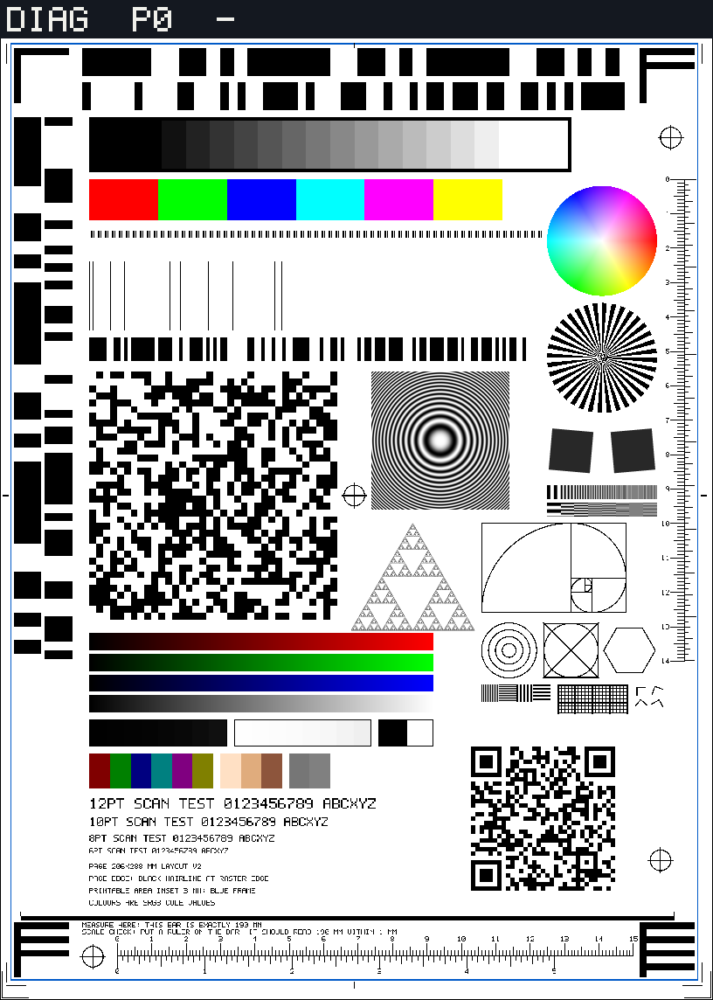

# Diag page, layout v2



`diag` is the self-describing test page ([patterns.md](patterns.md#diag-layout)). Layout v2 keeps every layout-v1 element
exactly where it was (fiducials, correlation strips, wedge, patches, bit comb, 1-px bars, raw strip, position array,
zone plate, QR) and adds print marks, rulers, resolution, colour and geometry targets in the areas v1 left empty, so one
page serves scanning, printing and print-then-scan loops. Pixels outside the v2 element boxes are identical to v1 (Rust
test `v2_changes_only_declared_regions_and_never_the_v1_content`, byte-hash test for `diag_v1`).

Selecting the layout:

| Pattern id | Page |
|------------|------|
| `diag` | layout v2 (default); the QR payload gains `\|lay=2`: `fakescan\|v1\|page=0\|pat=diag\|side=none\|lay=2` |
| `diag_v1` | the original layout, byte-identical to what `diag` rendered before v2; QR carries no `lay` (a missing `lay` means layout 1, so decoders for old pages keep working) |

## Coordinate system, determinism, colour

* Millimetres, origin top-left of the 206 x 288 mm layout box, x right, y down; `px = round(mm * dpi / 25.4)` at the
  effective dpi (a 300 dpi request renders 150 dpi because of the 4 MP cap). The raster is a little larger than the box
  (816 x 1144 px at 100 dpi = 207.3 x 290.5 mm).
* Elements with `anchor: "raster"` (page border, corner ticks) follow the raster edges instead of the layout box.
* Same parameters give the same bytes. Nothing depends on the page index except the QR.
* Colours are **8-bit sRGB code values** (no ICC conversion happens in the generator). The layout JSON says
  `colour_space: "sRGB"`; `png_bytes()` writes PNGs with `sRGB` (perceptual) and `gAMA` 45455 chunks, so this PNG is
  tagged.
* The tester banner (top ~11 mm) is still stamped over the page, so nothing of v2 sits above y = 12.5 mm.

## Elements

| Group | Element (layout id) | Position (mm) | What it shows |
|-------|---------------------|---------------|---------------|
| Frames | `page_border` | the raster edge | physical sheet edge: 1 px black hairline at the very edge of the raster (already in v1); `corner_ticks`: 8 mm L ticks 0.5 mm inside each raster corner (the top pair is under the banner) |
| | `printable_frame` | (3, 12.5)-(203, 285) | printable area: 0.4 mm **blue** (0, 90, 200) frame, inset 3 mm left/right/bottom, top just below the banner. Labelled on the page |
| | `sheet_a4`, `sheet_letter` | (0,0)-(210,297), (0,0)-(215.9,279.4) | dashed outlines, drawn only when the sheet fits inside the raster; neither does (the box is 206 x 288), so `drawn: false` and the sizes are only recorded |
| Marks | `crop_*`, `centre_mark_*`, `reg_bl/br/tr/centre` | margins; centres (27,278) (192,250) (195,40) (103,144) | crop marks 1.3 mm outside the frame, centre ticks on all four edges, 4 registration crosses (ring r 3.0 mm + arms) |
| Rulers | `ruler_metric_h`, `ruler_inch_h` | shared baseline y = 277.5, origin x = 34 | mm ticks (1.5 / 2.5 / 3.5 mm long at 1 / 5 / 10 mm) numbered per cm, 150 mm; inch ticks 1/16 in with 1/8, 1/4, 1/2, 1 in tiers numbered per inch, 5 in |
| | `ruler_metric_v`, `ruler_inch_v` | baseline x = 199, origin y = 52 | right edge: mm (numbered per cm, 140 mm) to the left, inch (1/16 in tiers, 5.5 in, unnumbered) to the right |
| | `measure_bar` | (6, 266.2)-(196, 267.4) | **exactly 190 mm** with end ticks; labelled "MEASURE HERE: THIS BAR IS EXACTLY 190 MM" and "SCALE CHECK: PUT A RULER ON THE BAR; IT SHOULD READ 190 MM WITHIN 1 MM". 200 mm / 8 in do not fit inside the frame, hence 190 mm; the inch baselines are the 5 in / 5.5 in rulers |
| Resolution | `siemens_star` | centre (175,104), r 16 | 36 cycles; cut-off radius gives lp/mm |
| | `slant_edge_a/b` | (166,131), (184,131) | 12 mm squares dark 40 on paper, rotated +5 / -5 deg, 4x4 supersampled (MTF / edge rise) |
| | `res_lines_v/h` | (159,141)-(191,145)/(146,150) | 8 patches of 4 mm, line pairs with period 2.0 1.0 0.75 0.5 0.4 0.3 0.25 0.2 mm (area-coverage rendered) |
| | `res_lines_px` | (140,199)-(160,204) | pixel-exact 1 px / 2 px line pairs, V and H (lost by any resampling; sizes in mm are nominal) |
| | `fine_grid` | (162,199)-(182,207) | 1 mm line grid, heavier every 5 mm |
| Colour | `hue_wheel` | centre (175,70), r 16 | full HSV circle, V = 1, S = r/R; hue 0 (red) at +x, increasing clockwise on screen |
| | `ramp_r/g/b/n` | x 26-126, y 184 + 6 i, 5 mm tall | 8-bit ramps, level = round(255 (x - 26) / 100) |
| | `near_black`, `near_white`, `clip_black`, `clip_white` | y 209-217 | levels 1 2 3 4 6 8 12 16 / 254 253 252 251 249 247 243 239 / 0 / 255, black outline so white is visible |
| | `half_primaries`, `skin_tones`, `mid_greys` | y 219-229 | R G B C M Y at 128, three skin tones, 118 (18 %) and 128 greys |
| | `wedge_grey16` (v1) | (26,34)-(166,50) | the 16-step grey ramp: 17 k |
| Text | `text_12pt/10pt/8pt/6pt`, labels | x 26, y 232-263 | built-in 5x7 uppercase font, cap height 0.72 em; analytic ink fraction in the layout |
| Geometry | `sierpinski` | apex up, base (102..138, 183.2), side 36 mm, depth 7 | self-similar: aspect, shear, rotation, down-scale aliasing; level-L holes have side 36/2^L (down to 0.28 mm) |
| | `golden` | (140,152)-(182,178), unit 2 mm | Fibonacci squares 13 8 5 3 2 1 1 (21 x 13 units) with the quarter-circle spiral; every square's size and every line position are in the JSON |
| | `concentric_circles`, `circle_in_square`, `hexagon` | (148,189) r 2 4 6 8; square (158,181)-(174,197); (183,189) R 7.5 | ellipse fits give anisotropy and shear |
| | `marker_0..3` | cells at y 199-207, x 184-193.5 | 2.4 mm right-angle markers rotated 0 / 20 / 40 / 60 deg |

Every element's JSON entry has `rect_mm`, `size_mm`, `anchor`, `since_layout`, `drawn`, `pixel_exact`, `expected`
(element-specific: ticks, radii, levels, spans, ...) and `samples` (ground-truth RGB at points, with a tolerance;
the layout test renders the page at 100/150/200 dpi and checks every sample).

### Rulers: nominal dpi and crispness

Ticks are 1 device pixel wide up to ~150 dpi (about 0.2 mm above that). Tick `i` is the pixel column (row) starting at
`round(pos_mm * dpi / 25.4)`: the error is at most half a pixel and never accumulates, so the pitch measured over the
whole ruler is exact. At 254 dpi every mm tick is pixel-aligned; at 100 dpi (the nominal 816 x 1144 raster) the inch ticks
at 1/4 in are (25 px) aligned, the others are rounded. A printed copy laid against a physical ruler or caliper shows the
x and y scale by eye: the 190 mm bar and the 5 in ruler must measure their nominal length at 100 %.

## Layout JSON and rendering from Python

```python
from fakescan import diag
layout = diag.diag_page_layout(100)          # dict, same data as fakescan::diag_v2::layout_json
img = diag.render_diag_page(100)             # PIL image, banner and QR included
png = diag.render_diag_png(100)              # bytes, sRGB declared
report = diag.analyze_diag_page(scan, layout)  # per-element report (below)
```

Rust: `fakescan::diag_v2::{layout_json(dpi, version), render(dpi, page, version), png_bytes(&img), draw(&mut img, dpi)}`;
`cargo test -p fakescan --lib write_doc_png` with `FAKESCAN_DIAG_PNG=<path>` rewrites this document's PNG.

## Analyzer report (fakescan-python `fakescan.diag.analyze_diag_page`)

The established blind analyzer for the v1 faults (flip / mirror / rotate / invert / BGR / bit order / shear) stays
`pdfcraft_fakescan.pattern_analyzer` and is unchanged; v2 adds this layout-driven analyzer for scale, margins, rulers,
colour and resolution. It assumes an upright page. Pure Python + Pillow.

* `geometry`: affine fit of the page from the four registration crosses (sub-pixel centroids): `px_per_mm_x/y`, `dpi_x/y`,
  `scale_x/y_vs_nominal`, `aspect_x_over_y`, `rotation_deg` (positive clockwise on screen), `shear` and `skew_deg`,
  `origin_offset_mm` (margin offset of the layout origin), fit residual.
* `elements[<id>]`: frames: which edges survived (`found`, `margin_mm`, `expected_margin_mm`, `margin_error_mm`,
  `clipped_edges`); rulers: ticks found, `dpi`, `scale_error_pct`, `length_error_mm/pct`; `measure_bar`: edge fit
  and the length error in mm and %; patches / ramps / wedge: per-sample RGB error, delta E 76, channel bias; clip
  detection from the near-black / near-white strips; `hue_wheel`: hue error (mean, max, rms) and saturation error;
  `res_lines_v/h`: modulation per period and `last_resolvable_period_mm`; `siemens_star`: cut-off radius and lp/mm;
  `slant_edge_*`: edge angle and 10-90 % rise; `golden`: recovered x/y px per mm from the square edges, aspect error
  and the width/height ratio vs 21/13; circles and hexagon: covariance ellipse fit (axis ratio, x over y, major-axis
  angle); `marker_*`: angle between the arms (90 deg expected); `sierpinski`: contrast per level and
  `smallest_resolved_level`; text: contrast and ink fraction vs expected; marks: presence.
* `summary`: the headline numbers (scale, aspect, rotation, shear, origin offset, clipped edges, clipped steps, ruler
  dpi per axis, measure bar error).

At identity (page against itself at 100 dpi): scale within 0.15 %, rotation < 0.05 deg, ramp RGB error <= 2 levels, hue
error < 3 deg, rulers within 0.3 %, measure bar within 0.15 mm. Injected 0.97 x 1.00 scale, 0.5 deg rotation, 0.01
shear, 103 % dpi mismatch, blur, clipping and hue shifts are recovered in `tests/test_diag_page.py`.

## Compatibility with layout v1 consumers

* `pattern_analyzer.analyze` (pdfcraft-fakescan) gives the same verdict on v1 and v2 pages at 100 / 200 dpi: every
  finding is equal except `px_per_mm_*` (differences <= 0.0002) and `offset_px` (<= 0.01 px), and
  `orientation_confidence` (a whole-page profile score) falls from about 0.33 to 0.30 because the added ink adds
  structure to the profiles. Orientation, scale, shear, bit order, thresholding and raw BER results are unchanged.
* Everything a v1 consumer reads is in the same place; QR decoders that ignore unknown fields are unaffected (`lay=2` is
  appended after `side=`, before any `client=`).
