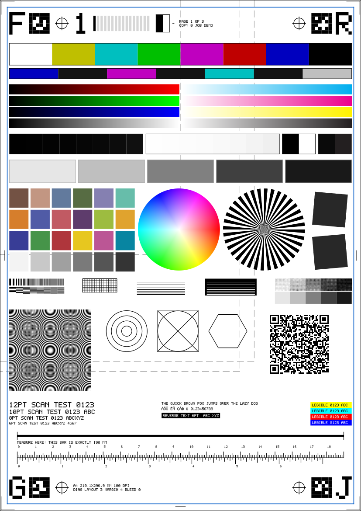
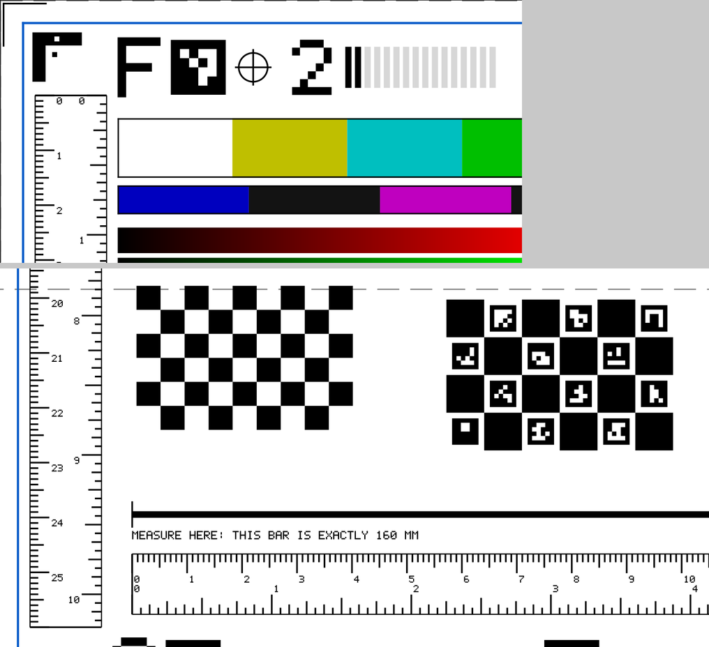

# Diag page, layout v3 (the default `diag`)





Layout v3 is a **parametric generator**, not a picture. No page is stored anywhere: the raster, the layout JSON, the
vector primitives and the QR payload are all produced by one deterministic function of the page parameters
(`fakescan::diag_v3`, Python `fakescan.diag`). The PNGs in this directory are rendered examples only; no test reads them.

**Revision 1** (this document describes it; `layout_revision: 1`, still `layout_version: 3`, QR `lay=3|rev=1`) adds the
computer-vision fiducials and the dual-unit rulers: OpenCV-compatible ArUco `DICT_4X4_50` markers at the four corners and
the four edge midpoints, a chessboard, a ChArUco board, an asymmetric circle grid, black / white corner L-brackets and
dual-sided rulers on both axes. Revision 0 (the first v3 pages, private 4x4 markers, two separate rulers) is not
reproducible from a payload any more; its payloads still decode (no `rev` key reads as revision 0, `diag_spec_from_qr`
returns `layout_revision: 0`) and regenerate the page as revision 1. `diag_v2` / `diag_v1` are untouched.

Why a new layout: v1 / v2 are a fixed 206 x 288 mm box, crowded, and written for one device. v3 keeps what v2 proved
(frame, registration crosses, rulers, a measure bar, resolution and tone targets) and adds what the
[printer test page survey](#survey-and-what-v3-covers) ranked highest, for any sheet size, so the same page serves a scanner (sheet
size and dpi of the device, 4 MP cap) and a printer (PDF at the exact physical size, see "Using it from fakeprint").

## Parameters (`PageSpec`)

| Parameter | Meaning |
|-----------|---------|
| `paper` | `A0`..`A6`, `B4`, `B5` (ISO), `JIS-B4`, `JIS-B5`, `LETTER`, `LEGAL`, `TABLOID`, `LEDGER`, `EXECUTIVE`, `STATEMENT`, `FOLIO`, or custom `210x297` (mm) |
| `orientation` | `portrait` (default) or `landscape` |
| `width_mm`, `height_mm` | custom sheet in mm (overrides `paper` for the size) |
| `width_px`, `height_px` | exact raster size (the scanner path uses this: the device's pixels) |
| `dpi` | pixels per inch; pixel size = `round(mm * dpi / 25.4)` |
| `margin_mm` | printable-area margin (default 4); the blue frame sits at the margin |
| `bleed_mm` | > 0 adds flush edge bars and records the bleed box (outside the raster, `drawn: false` by nature) |
| `page`, `copy`, `total` | 0-based page index, copy index, pages in the job (0 = unknown) |
| `side` | `front` / `back` (duplex face), omit for simplex |
| `job` | short job tag (A-Z, 0-9, `-`, `_`, 16 chars) |
| `colour` | `rgb` (default) or `gray` (luma replicated; layout samples are converted) |
| `rulers` | `metric`, `inch` or `both` (default): which scales of the dual-sided rulers are drawn; recorded in the layout `spec` and the QR (`rl=`) |
| `banner_px` | height of a tester banner the caller stamps over the top (the scanner does): the frame and content start below it |

The same parameters give the same bytes. A QR in the page carries them, so a decoder can regenerate the expected page:

```
fakescan|v1|page=2|pat=diag|side=front|lay=3|paper=A4|px=816x1144|dpi=100|m=4|b=0|copy=1|of=4|bn=44|g=0|rev=1|rl=both|ar=4x4_50|id=0-19|job=AB-1
```

`lay=3` marks the layout version (v1 pages carry no `lay`, v2 carries `lay=2`); `rev=` the revision inside layout 3,
`rl=` the rulers parameter, `ar=` the ArUco dictionary (`4x4_50` = OpenCV `DICT_4X4_50`) and `id=` the marker ids on the page
(0-7 layout markers, 8-19 the ChArUco board). Decoders must ignore keys they do not know and treat missing `rev` / `rl` as
revision 0 / `both`. `PageSpec::from_qr_payload` /
`fakescan.diag.diag_spec_from_qr` invert it. (The scanner does not add `job=` or `client=`: the default page must be
byte-stable across connections.)

## How it scales

The page is a stack of rows inside the printable frame (printable frame minus a 1.4 mm pad). Block boxes (colour bars,
patch grids, wheels, geometry) scale by one factor `s` (0.55 to 2.0, the largest that fits; A4 at 100 dpi gets about 1.5,
A5 about 1.0, A3 the maximum 2.0). Detail that is physical stays physical: line-pair periods, line weights, text
point sizes, tick pitch, ruler and measure-bar length (the longest multiple of 10 mm that fits). If a row does not fit
at the minimum factor, optional blocks are dropped first (grid, halftone, text-on-colour, pangram), then whole rows by
priority; the top / bottom bands and the QR row are mandatory. Everything dropped stays in the layout with
`drawn: false` and a `reason`; `scale` is recorded on every element. Leftover height is spread between rows.

Landscape sheets use the same rows at the wider width; custom sizes work the same way.

**Fiducial columns.** When the content box is at least 120 x 150 mm (A5 and up) the rows live between two 15 mm
columns at the left and right edge. Each column holds, top to bottom: a corner L-bracket, the vertical dual-sided
ruler, the edge-midpoint ArUco marker (in a window of the ruler: no tick or label inside the marker or its quiet zone,
`masked_mm` records it) and the bottom L-bracket. Smaller sheets drop the columns (`drawn: false`,
`reason: content box too small ...`); the horizontal ruler row, the corner markers and the top / bottom midpoint markers
stay. Boards are a row of their own (priority 6: dropped before the resolution row on tight sheets) whose chessboard
square (3.5 mm x scale), ChArUco square (5.5 mm x scale) and circle pitch (3.0 mm x scale) follow the block scale;
below the documented minima (2.4 mm square, 0.7 mm ArUco module in the ChArUco board) the board is recorded as not drawn.

## Elements

| Group | Element ids | What it shows / reveals | Machine check |
|-------|-------------|-------------------------|---------------|
| Print marks | `page_border`, `corner_ticks`, `edge_tick_*`, `printable_frame` (blue, 0.4 mm), `outline_a6..a3` (dashed grey media outlines anchored top-left, drawn only when the medium is smaller than the sheet in both directions), `bleed_probes` (when `bleed_mm` > 0) | cropping, margins, centring, scaling to media | frame edge positions, clipped edges; outline samples |
| Fiducials | `reg_tl/tr/bl/br` (ring + cross), `marker_tl/tr/br/bl` + `marker_tm/mr/bm/ml` (ArUco `DICT_4X4_50` ids 0..7: corners clockwise from the top-left, then edge midpoints clockwise from the top; module >= 1.0 mm, one module of quiet zone), `bracket_tl/tr/bl/br` (black L with a white mark in the horizontal arm whose distance from the elbow differs per corner and a black mark in the inner corner), `qr` | affine fit (scale x/y, rotation, shear, offset), homography, pose, flip / mirror / rotation, sub-pixel corner positions | cross centroids, marker corners (python or cv2), QR payload |
| Orientation | `orient_tl/tr/bl/br`: asymmetric glyphs F, R, G, J per corner; the **back** side mirrors each glyph and rotates the assignment (J, G, R, F) | rotate 180, mirror, flip long / short edge, wrong duplex side | glyph bitmap in the layout; the analyzer tests 4 transforms |
| Page order | `page_number` (big digits of page+1), `order_bars` (page+1 filled bars of 16, the old `page_id` cue), `side_marker` (front inks the left half, back the right, plus label), `page_stamp` (page / total, copy, job) | multi-page order, duplex pairing, copy counting | digit decode, bar count, side read |
| Colour | `ebu_bars` (EBU 100/0/75/0), `smpte_castellation`, `colorchecker24` (24 sRGB values), `ramp_r/g/b/n` (black to primary), `ramp_c/m/y/k` (paper to the declared sRGB full tint of cyan (0,174,239), magenta (236,0,140), yellow (255,242,0), black (35,31,32)), `hue_wheel`, `rich_black` (10,10,10) and `k100` patches | channel order / swap, hue, saturation, chroma, tone curve | ΔE76 per patch, channel permutation, monotonic ramps |
| Tone | `near_black`, `near_white`, `clip` (0 / 255), `flat_10/25/50/75/90` (ink %), `halftone_ladder` (45 degree dot screens at 10/25/50/75/90 % over solid references) | clipping, banding, streaking, uniformity, mottle, dither / moire | flat-field stdev, row and column ranges, halftone mean |
| Resolution | `siemens_star`, `slant_edge_a/b` (+5 / -5 deg), `res_lines_v/h` (periods 2 .. 0.2 mm), `zone_plate` (up to 4 cycles/mm at the half-width), `fine_grid`, `line_ladder_pos/neg` (0.25 .. 2 pt, positive and reverse) | MTF cut-off, resampling kernel, aliasing, thin-line dropout | modulation per period, thinnest visible line |
| Geometry | `concentric_circles`, `circle_in_square`, `hexagon` | aspect ratio, shear | ellipse fit (analyzer reads the layout's centres / radii) |
| Calibration | `chessboard` (9 x 6 squares, 8 x 5 inner corners, top-left square black), `charuco_board` + `charuco_marker_8..19` (6 x 4 squares, OpenCV >= 4.6 non-legacy layout, `DICT_4X4_50` ids 8..19, 15 inner corners), `circle_grid` (OpenCV asymmetric grid, 6 per row x 5 rows, diameter 0.55 x row pitch) | sub-pixel calibration, lens / sensor scale, circle centroid bias | `cv2.findChessboardCorners`, ChArUco interpolation, `cv2.findCirclesGrid`; circle centroids in pure Python |
| Scale | `measure_bar` (exactly N mm, end ticks), dual-sided rulers: horizontal `ruler_metric` / `ruler_inch`, vertical left `ruler_v_metric` / `ruler_v_inch`, vertical right `ruler_vr_metric` / `ruler_vr_inch`. Metric on one edge of the strip (1 mm short, 5 mm medium, 10 mm long tick, numbered per cm), inches on the opposite edge (1/16, 1/8, 1/4, 1/2, 1 in tiers, numbered per inch), both from the same zero line | x and y scale at 100 % per unit | tick regression, bar length |
| Text | `text_12pt/10pt/8pt/6pt`, `pangram`, `latin_sample` (accents composed on the 5x7 pixel font: A O U E N C A O ss), `reverse_text`, `text_on_colour` (6 pt on yellow, cyan, red, blue), `legend` | font rendering, small text, reverse text, text on colour | ink fraction vs the analytic value, contrast |

The built-in 5x7 font is uppercase Latin: no TrueType font is embedded, so there is no real Unicode sample (see
"What is still missing").

## Layout JSON (ground truth) and vector primitives

`fakescan.diag.diag_page_layout(dpi, paper=..., ...)` / `fakescan::diag_v3::build_layout(&spec).json()`:

* header: `layout_version` 3, `colour_space` `sRGB`, `spec` (the full parameters), `raster_px`, `px_per_mm`, `scale`, `frame_mm`,
  `content_mm`, `bleed_box_mm`, `banner_reserve_mm`, `qr_payload`, `notes`;
* `elements[]`: `id`, `kind`, `group`, `rect_mm`, `size_mm`, `since_layout` (3), `drawn`, `scale`, `reason` (when not drawn),
  `expected` (element-specific: palettes, periods, bitmaps, tick pitch, ...), `samples` (`x_mm`, `y_mm`, `rgb`, `tol`:
  the code value expected at that point; the Rust and Python tests render the page at several sizes and dpis and check
  every sample);
* `marker` elements (`kind: marker`, also the ChArUco markers): `expected` = `marker_id`, `dictionary` (`DICT_4X4_50`),
  `position`, `rect_mm`, `corners_mm` (**TL, TR, BR, BL** of the marker in its canonical, upright orientation, the order
  `cv2.aruco` returns), `module_mm`, `modules` (6 incl. border), `quiet_zone_mm` (>= one module), `cells` (6 x 6, `1` = black),
  `payload_hex`, `opencv` (the call that rebuilds it);
* `ruler` elements: `unit`, `mm_per_unit`, `axis` (`x` / `y`), `direction` (`+x` / `+y`), `origin_mm`, `zero_line_mm`,
  `tick_edge_mm` (the edge the ticks start from), `ticks_point`, `pitch_mm`, `tiers` (every N-th tick has the length),
  `ticks` = `{index, pos_mm, length_mm}` (position from the zero line, only ticks that are drawn), `masked_mm`, `labels`,
  `span_mm`, `strip_rect_mm`;
* boards: `chessboard` (`squares`, `inner_corners`, `square_mm`, `origin_mm`, `inner_corner_positions_mm`), `charuco_board`
  (`squares`, `square_mm`, `marker_mm`, `marker_ids`, `legacy_pattern: false`, `chessboard_corners_mm` in OpenCV corner id
  order, per-marker `corners_mm`), `circle_grid` (`per_row`, `rows`, `row_pitch_mm`, `circle_diameter_mm`, `centres_mm` row-major);
* `primitives[]`: the drawing in paint order, millimetres, page coordinates, each with `id` (the element) and `vector`.
  Vector ops: `rect`, `polygon`, `line` (optionally dashed), `circle`, `text` (5x7 pixel font; `pt`, mirror flag), `grating`
  (bar patch), `ticks` (ruler ticks with tiers; horizontal rulers only). The revision-1 fiducials add **no new op**: ArUco
  modules, chessboard / ChArUco squares, brackets and the vertical ruler ticks are `rect` ops (touching modules are already
  merged into maximal rectangles and the rasteriser unions them without seams), the circle grid is 30 `circle` ops.
  A PDF writer that handles the existing ops reproduces them at any size. Raster-only ops (`vector: false`): `ramp` (gradient), `hue_wheel`,
  `siemens_star`, `zone_plate`, `halftone`, `qr` (carries the payload). `fakescan.diag.diag_page_primitives(layout)` returns them.

Pixel `i` covers `[i / k, (i + 1) / k)` mm, `k = dpi / 25.4`; edges are anti-aliased by exact area coverage, so hairlines
render grey at low dpi (samples on hairlines use a large tolerance). Colours are 8-bit sRGB code values; no ICC
conversion happens. PNGs carry `sRGB`, `gAMA` and a `pHYs` chunk with the physical size.

## API

Rust: `fakescan::diag_v3::{PageSpec, build_layout, rasterize, render, png_bytes, paper_size_mm}`
(`PageSpec::from_paper("A4", landscape, dpi)`, `from_mm`, `from_px`, `from_json`, `qr_payload`, `from_qr_payload`).

Python (needs the native module):

```python
from fakescan import diag
lay = diag.diag_page_layout(300, paper="LETTER", page=1, total=3, side="back", job="t1")   # dict
img = diag.render_diag_page(300, paper="LETTER", page=1, total=3, side="back", job="t1")   # PIL image
png = diag.render_diag_png(300, paper="A4", orientation="landscape")                       # bytes, sRGB + pHYs
prims = diag.diag_page_primitives(lay)                                                     # vector description
spec = diag.diag_spec_from_qr(lay["qr_payload"])                                           # regenerate from the QR
rep = diag.analyze_diag_page(scan, lay)    # v3 layouts dispatch to fakescan.diag3.analyze_v3
```

`version=2` / `version=1` select the fixed layouts (their analyzer is unchanged).

### Analyzer report (`fakescan.diag3.analyze_v3`)

Driven only by the layout. `geometry`: affine fit from the four registration crosses (`px_per_mm_x/y`, `dpi_x/y`,
`scale_*_vs_nominal`, `aspect_x_over_y`, `rotation_deg`, `skew_deg`, `origin_offset_mm`, residual). `elements[<id>]`:
`colorchecker24` (mean / max ΔE76, worst patch, `channel_order` such as `bgr`), ramps (max error, monotonic), flat fields
(mean, error, stdev, row / column range), markers (rotation), rulers (`px_per_mm`, `pitch_error_pct`), `measure_bar`
(length error mm / %), `printable_frame` (per-edge error, clipped edges), `res_lines_*` (modulation, last resolvable
period), `line_ladder_*` (thinnest visible pt), `halftone_ladder` (mean error), `zone_plate` (contrast by radius), text
(ink fraction), other sampled elements (RGB error, ΔE). `elements["orientation"]` (verdict `upright`, `rot180`, `flip_h`,
`flip_v` from the four corner glyphs), `elements["page_order"]` (page number read, bar count, side read). `summary` has the
headline figures. Revision-1 additions:

* `markers`: `detector` (`cv2` or `python`), `n_expected` / `n_found`, `missing`, `per_marker[id]` (decoded id, rotation,
  mirror, `corner_err_mm` per corner, `max_err_mm`, `max_err_px`, `centre_err_px`), `rms_corner_err_mm`,
  `affine` (scale x / y, dpi x / y, rotation, `mirrored`, residual in mm from the marker corners alone), `homography`
  (matrix, `residual_rms_mm`, `residual_max_mm`), `orientation`. The pure-Python
  detector locates each marker near the fitted page affine (+-3 mm window; the ring-contrast locator returns the centroid
  of its plateau, which is good to a fraction of a module) and refines the outer border to a sub-pixel quad: edge profiles
  at quarter-pixel spacing on the four sides, each reduced to the **integral of the ink fraction** along the profile (the
  exact edge position for an area-averaged raster or any symmetric blur; a mid-level crossing is biased by up to a quarter
  pixel depending on the edge's sub-pixel phase), a robust (Theil-Sen, then least squares) line per side so one profile that
  crosses a neighbouring feature is dropped, and the corners as the line intersections. The position is re-centred on the fitted
  quad and refined again before the payload is read. On clean renders every marker is found and the worst corner is
  under 0.3 px at 100-600 dpi on A4 / Letter / A5 (in practice 0.01-0.1 px; exceptions are markers with real ink on their
  edge, such as the Statement media outline crossing ChArUco markers on Letter). `cv2.aruco` (`CORNER_REFINE_SUBPIX`) is
  used instead when `cv2` with the aruco module is importable (`detector="auto"`; `"python"` / `"cv2"` force one).
* `markers.orientation`: the dihedral state of the received page, one of `upright`, `rot90`, `rot180`, `rot270` (the page
  turned that many degrees clockwise), `flip_h`, `flip_v`, `transpose` (mirrored along the top-left to bottom-right diagonal, PIL
  `Image.TRANSPOSE`) and `anti_transpose` (`Image.TRANSVERSE`); `unknown` when no marker was read. Every decoded marker carries
  the transform of the page in its own module pattern (the decoder tries the 8 symmetries) and its decoded id says where on
  an upright sheet it belongs; each state is scored by the markers whose pattern transform equals it plus the markers whose
  decoded id sits, under that state, where it was found, so a page rotated 180 degrees (every marker decodes as another
  id) is `rot180`. `fix` is the PIL `Image.Transpose` member that restores the page, `ambiguous` flags a tie.
  `fakescan.diag_markers.detect_orientation(image, layout)` needs no page fit and so also names the axis-swapping states:
  the raster is transformed by each of the eight fixes and the fix under which most of the eight edge / corner markers decode
  as themselves wins. When the page fit fails (a rotated-by-90 raster has no crosses where they belong) `analyze_v3` still sets
  `summary.marker_orientation` and `markers.orientation` from it.
* `scan_dpi` (`analyze_v3` / `analyze_diag_page`): the resolution the raster is supposed to have. The page fit's plausibility test
  (scale within 0.4x..2.5x of nominal, skew under 20 degrees) and all dpi-relative figures use it; without it the layout's
  `dpi_effective` is assumed. A layout generated at 400 dpi (the fakeprint PDF adapter) analysed on a 150 dpi raster needs
  `scan_dpi=150`; a raster whose scale is implausible for `scan_dpi` is still refused (`fit: failed`).
* `rulers`: per axis (`x`, `y`) and unit (`mm`, `in`) the longest ruler: `dpi`, `baseline_mm`, `length_error_mm` (absolute error
  of the outermost ticks over the baseline), `pitch_error_pct`; the same per ruler under `elements`.
* `elements.chessboard` / `charuco_board` / `circle_grid` (corner count, mean / max error in mm; corner interpolation needs cv2,
  circle centroids and the ChArUco markers do not).
* Fit policy: `geometry.fit` is `crosses` (default), `markers` (fewer than three real crosses survived and the markers give
  the affine; `marker_fallback=False` disables it) or `failed` (`summary.fit == "failed"`, no element report, never a fit to
  clutter). A cross is real when its score is at least 40 % of the best cross and 25 % of the page contrast
  (`WEAK_CROSS_REL`, `WEAK_CROSS_ABS`); a fourth cross that disagrees with the other three is dropped; with only three crosses the
  markers must confirm the fit (`geometry.marker_check`).
* `printable_frame` is colour-mode aware: colour pages score `blue - red`; grey / mono pages (the layout says `gray`, or the
  image carries no colour) score luminance contrast against the local paper and ignore dark runs that belong to other known
  elements, so a mono page reports `clipped_edges: []` and a cut edge is still found missing (`mode: mono`).

At identity the scale error is < 0.5 %, rotation < 0.05 deg, ΔE76 < 1; injected 0.97 x scale, 0.5 deg
rotation, BGR swap, 180 deg rotation and mirrors are recovered in `tests/test_diag_v3.py`.

## Using it from fakeprint (vector PDF)

`diag_page_layout(...)` plus `diag_page_primitives(...)` give everything needed to draw the page at the exact physical size
in a PDF: draw the `vector: true` primitives with a PDF writer (mm to points: x 72 / 25.4, y flipped), and crop the
`rect_mm` of each raster-only element out of `render_diag_page(dpi, ...)` at a high dpi (or draw a PDF shading for `ramp`
and a QR from `payload`). The same layout JSON is the analysis ground truth after the print-scan loop.

## Versions, pins, compatibility

| Pattern | Page | Pin |
|---------|------|-----|
| `diag` | layout v3 revision 1 (default) | `diag_v3::tests::pinned_hashes`: FNV-1a 64 of the RGB raster, A4@100 `f8611b691b27e9bc`, Letter@100 `9e2ca63d82d82af6`, A3@50 `6200ed7de6f91e9e` (revision 0 was `f6aa3fda618d9b02`, `beeebc4399ab038c`, `6aaaebb13625058a`) |
| `diag_v2` | layout v2, `lay=2` | `diag_v2_is_byte_identical_and_still_selectable` (100 and 200 dpi) |
| `diag_v1` | layout v1, no `lay` | `diag_v1_is_byte_identical_to_the_pre_v2_page` |
| `page_id` | numbered bars (old default) | selectable; `--default-pattern page_id` |

* v3 is **not** v2 plus additions: the elements are placed by the generator, so the v1 fiducials, position array and
  correlation strips (which `pdfcraft_fakescan.pattern_analyzer` blind-decodes) are not on the page. Loops that depend on
  that analyzer must select `diag_v2`; see "Consumers" below.
* The multi-page order cue of `page_id` (numbered bars + a banner) lives on v3 as `order_bars`, `page_number`, `page_stamp`
  and the QR (`page=`); the JPEG COM `fakescan-page:N` marker is unchanged.

## Consumers (what must change)

* `pdfcraft-fakescan` (`print_scan_loop.py` line ~121, `scalingmatrix.py` ~143 / ~157, `scanloop.py` ~167 / ~413) and
  `pdfcraft-fakeprint` (`printloop.py` ~90) call `set_pattern("diag")` and read it with the blind `pattern_analyzer`
  (v1 layout). They must select **`diag_v2`** (the old `diag`, byte-identical) or be ported to a v3 reader.
* `pdfcraft-fakeprint/printloop.py` ~611 calls `fakescan.diag.diag_page_layout(dpi=...)`, whose default is now version 3:
  pass `version=2` there, or use v3 with `paper` / `margin_mm` and the v3 analyzer.
* `POST /v1/loopback` (docs in pdfcraft-fakescan) resets to the default pattern, now `diag`.
* Nothing in those packages decodes the numbered bars of `page_id`; page order in the harness comes from the JPEG COM
  marker and the QR.

## Notes for consumers of revision 1

* Element ids changed or appeared: `marker_tl/tr/bl/br` are now ArUco (ids 0, 1, 3, 2) and `cells` keeps the 6 x 6 format
  (`1` = black), `ruler_metric` / `ruler_inch` are one dual strip (same ids, new `expected` keys: `axis`, `zero_line_mm`,
  `tick_edge_mm`, `ticks`; `origin_mm` is now the zero point on the tick edge, `direction` is `+x` / `+y`), vertical rulers
  `ruler_v_*` / `ruler_vr_*`, markers `marker_tm/mr/bm/ml`, `bracket_*`, boards. The rows live between the fiducial columns, so
  every `rect_mm` moved.
* `fakeprint-python` `testpage.layout_for`: all new geometry arrives as the existing vector ops (`rect`, `circle`, `text`,
  `ticks`), no adapter change is needed; `rect` ops of one element may now touch each other (draw them without anti-aliased
  seams or merge them). Raster-only ops are unchanged.
* The rulers' `ticks` op still exists for the horizontal rulers; the vertical rulers are `rect` ops because the markers leave a
  window in them.
* Scaling suites that read `ruler_metric` / `ruler_inch` through `pitch_error_pct` keep working; prefer `report["rulers"]`
  (dpi per axis per unit, error over the baseline) and `report["markers"]`.

## Survey and what v3 covers

Ranked findings and sources: `pdfcraft-notes/print/test-page-survey.md`. Implemented from its P1 / P2 list: ColorChecker 24,
EBU / SMPTE bars, orientation glyphs and duplex markers, OpenCV-compatible ArUco corner and edge markers (revision 1; revision 0 had a private 4x4 dictionary), zone plate, flat fields at
5 tones, line-weight ladder (positive and reverse), CMYK-ish separation ramps and a rich-black patch, halftone ladder,
text on colour, reverse text, accent sample, page / copy stamp, dashed media outlines, bleed probes. Earlier layouts already
had slanted edges, Siemens star, line pairs, hue wheel, grey ramps, near-black / near-white, rulers, measure bar.

## What is still missing

* Real Unicode text (no embedded font; only an accent set on the pixel font).
* AprilTag `tag36h11` (its dictionary is a fixed table that cannot be derived procedurally here; the ArUco 4x4 set and
  the QR cover the same use) and a DataMatrix.
* USAF-1951 bars, an OECF / gamma grey ring, transparency swatches, a dot-gain / ink-limit set, ghosting / show-through
  and paper-skew tests (these need physical media or a different output model, not an sRGB raster).
* `total` is not passed by the scanner (the page stamp reads "PAGE n" there); set it through `PageSpec` for print jobs.
* Colour mode `gray` replicates luma; real 1-bit / CMYK output modes are applied downstream by the encoder.
