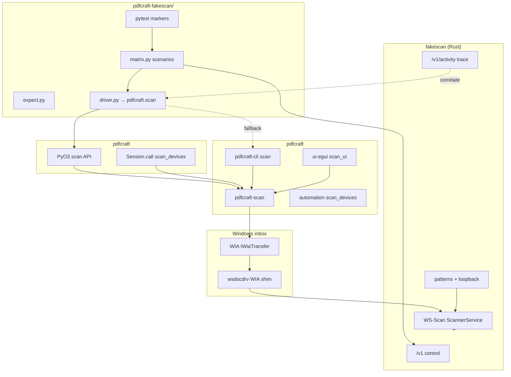

# Scan quality, harness, and UI — comprehensive plan

Living plan for **fakescan + pdfcraft** scan work: make failures diagnosable, prove image and settings fidelity end to end, and keep the desktop UI honest during long WIA transfers. Operator docs stay in [lab-harness.md](lab-harness.md), [pdfcraft-e2e.md](pdfcraft-e2e.md), [windows.md](windows.md); bug notes in [pdfcraft-findings.md](pdfcraft-findings.md).

**Last updated:** 2026-10-12  
**Baseline matrix:** `cd pdfcraft-fakescan && pytest -m pdfcraft_wia` — re-run when Fake WSD is in Imaging (16 scenarios × cli/native when bindings installed). Offline harness: `pytest -m "not pdfcraft_wia"` → **19 passed** (2026-10-12).

---

## 1. Goals

| Goal | Meaning |
|------|---------|
| **Reproducible WIA E2E** | Any developer with Fake installed can run one pytest marker and get pass/fail with human-readable reasons, not HRESULT soup. |
| **Layered ground truth** | Know which assertions need byte identity vs pixels vs QR/COM markers vs golden error sentences. |
| **Product parity** | CLI, UI, and (eventually) MCP report the same acquire outcomes, partial saves, and progress semantics. |
| **Image fidelity** | Orientation, color mode, DPI, brightness/threshold, and duplex order are testable without eyeballing BMPs. |
| **Responsive UI** | Long JFIF transfers show byte progress; cancel works; jam/offline mid-job still surfaces streamed pages and clear status text. |
| **Install durability** | Stale WIA trees, ghost AEP, and profile-at-Add-time are detected early with scripted hints, not silent skips. |

**Non-goals (this plan):** silent Windows “install scanner” without a person; TWAIN/SANE; committing Acrobat assets; running fakescan elevated.

**Target integration:** **pdfcraft-fakescan** should drive pdfcraft through **pdfcraft** (in-process `pdfcraft-scan`), not subprocess `pdfcraft-cli`. CLI remains the human/agent shell wrapper and parity oracle; pytest and lab tools prefer bindings.

---

## 2. System map (target: pdfcraft in the harness)



**Dependency rule:** pdfcraft does **not** depend on fakescan at build time. **pdfcraft-fakescan** may take an **optional** dependency on **pdfcraft** (`pip install -e ".[pdfcraft]"` in that repo). fakescan’s `fakescan-python` package (sibling repo) is the SOAP/control client only. Matrix failures still land in [pdfcraft-findings.md](pdfcraft-findings.md).

---

## 2b. Why pdfcraft for the harness (not CLI subprocess)

Today `pdfcraft-fakescan/pdfcraft_fakescan/driver.py` (and pdfcraft’s own benches: `scripts/bench_bed_scan.py`, `bench_acquire_settings.py`) shell out to `pdfcraft-cli scan` when native bindings are unavailable. That works but limits what the lab can observe:

| Subprocess CLI | pdfcraft bindings |
|----------------|---------------------|
| Parse stdout JSON; stderr merge by convention | Structured `ScanResult` / exceptions with `ScanError` kind |
| No progress during acquire | `ProgressToken` polled from Python (bytes, page count, streamed pages) |
| Hard to test cancel mid-transfer | `CancelToken.request()` from another thread |
| Two binaries can drift (`PDFCRAFT_CLI` vs wheel) | Same `pdfcraft-scan` crate revision as the wheel |
| Slow process spawn per matrix row | In-process acquire (matters for 12+ scenarios) |

**Principle:** fakescan arms the **device** (SOAP + `/v1`); pdfcraft exercises the **same code path as the UI** (`pdfcraft_platform::scan::acquire`). CLI stays for copy-paste repro and CI that only installs the binary.

### 2b.1 Binding surface to add (pdfcraft)

Implement in **pdfcraft** first (pdfcraft repo ships the Rust API; pdfcraft wraps it). Suggested module `pdfcraft.scan` (names are indicative):

```python
# python/pdfcraft/scan.py — thin wrapper over new PyO3 types

def list_scanners() -> list[ScannerInfo]: ...
def acquire(settings: AcquireSettings, *, out_dir: Path | None = None) -> AcquireResult: ...
# AcquireSettings: device_id, source, pages, dpi, color, format, brightness, …
# AcquireResult: pages: list[AcquiredPage], error: ScanError | None, partial: bool
# AcquiredPage: path | bytes, width, height, dpi, format

class ScanProgress:
    """Handle from acquire(..., progress=ScanProgress()) — poll pages_done, page_percent, bytes_received."""

class ScanCancelled(Exception): ...
class ScanFailed(Exception):
    message: str
    kind: Literal["failed", "incomplete", "cancelled"]
    pages_acquired: list[AcquiredPage]
```

**Rust:** new `pdfcraft` crate module calling `pdfcraft_scan::{scanners, acquire, ScanSettings, ProgressToken, CancelToken}` directly (same as `pdfcraft-cli` / `scan_ui`), not re-parsing JSON. Optional: expose `wia_error_message` for golden-sentence tests in Python without subprocess.

**Automation path (interim):** `Session.call("scan_devices", {})` already maps to automation today; add `scan_acquire` tool in pdfcraft automation, then `session.call("scan_acquire", {...})` until the dedicated PyO3 API exists. Prefer **direct scan binding** for progress/cancel/partial pages — automation JSON is awkward for streaming.

**Windows-only:** gate with `sys.platform == "win32"` or lazy import; Linux CI keeps SOAP matrix without the extension.

### 2b.2 pdfcraft-fakescan harness migration

| Step | Work |
|------|------|
| 1 | pdfcraft: `list_scanners` + `acquire` PyO3 + stubs in `_native.pyi` |
| 2 | pdfcraft-fakescan: optional extra `[project.optional-dependencies] pdfcraft = ["pdfcraft"]` |
| 3 | `driver.py`: `CliBackend` (env `PDFCRAFT_CLI`) vs `NativeBackend` (import `pdfcraft.scan`; env `FAKESCAN_PDFCRAFT_BACKEND`) |
| 4 | pytest fixture: prefers native when importable; `FAKESCAN_PDFCRAFT_BACKEND=cli` forces subprocess for bisect |
| 5 | Port `try_acquire_scan`, `list_scanners`, progress/cancel tests to native |
| 6 | Deprecate `PDFCRAFT_CLI` as default on Windows dev boxes; keep for release-binary-only CI |

**Fidelity helpers stay in pdfcraft-fakescan:** `compare_acquired_to_originals`, QR/COM asserts, and `/v1/activity` correlation remain harness concerns; they consume **paths or bytes** from either backend.

### 2b.3 Instrumentation from one lab process

With bindings, a single pytest can:

1. `Client.reset()` + arm scenario on fakescan HTTP.
2. `progress = ScanProgress()`; start `acquire(..., progress=progress)` in a thread.
3. Poll `progress.bytes_received` while asserting fakescan `/v1/activity` shows RetrieveImage.
4. On failure, attach `ScanFailed.message`, partial `pages_acquired`, and last 10 activity events — no log archaeology.

Optional **fakescan MCP** (`fakescan-mcp`) stays HTTP-only; a future **combined lab** could run fakescan + import pdfcraft in the same Python MCP server for “arm fault → acquire → assert” without spawning CLI.

### 2b.4 Parity and versioning

- Pin **pdfcraft** version (or path dep) in pdfcraft-fakescan dev docs when chasing scan bugs.
- Keep one **CLI golden test** in pdfcraft-fakescan: native acquire vs CLI acquire on the same arm → same page count, dimensions, and error class (allows small pixel diff on WIA).
- Document `maturin develop` + `pip install -e ../pdfcraft-python` beside `pip install -e ../pdfcraft-fakescan` for WIA developers.

---

## 3. Ground truth tiers

Use the **weakest tier that still catches the bug** — WIA re-encodes; do not demand byte identity on the Imaging path unless loopback + format forces it.

| Tier | Mechanism | Best for | Typical command / API |
|------|-----------|----------|------------------------|
| **T0 — Protocol** | SOAP faults, job state, digests | Jam/offline/MustHonor, order | `test_local_matrix.py`, `test_live_faults.py` |
| **T1 — Hard loopback** | `POST /v1/loopback` → exact JFIF echo | Transport integrity (SOAP) | `fakescan-lab loopback-soap` |
| **T2 — WIA loopback** | Same bytes through WIA Download | Driver encode path | `09c_loopback_wia` (currently **timeout** on glass; SOAP OK) |
| **T3 — Pixel soft** | Pillow mean abs delta vs original | WIA re-JPEG | `compare_acquired_to_originals(mode=pixels)` |
| **T4 — Semantic markers** | JPEG COM `fakescan-page:N`, `fakescan-side:` | Page order, duplex side | `assert_jpeg_com_markers` |
| **T5 — QR payload** | `fakescan\|v1\|page=…\|pat=qr` | Decode without OCR | scenario `qr` + zxing/rqrr in pytest |
| **T6 — Layout oracles** | Synthetic patterns (`wedges`, `patches`, `slant_f`, `corners`) | Tone, color, orient, crop | `POST /v1/scenario` + sampled pixels / CV checks |
| **T7 — Human messages** | Golden sentences JSON | User-facing errors | `pdfcraft_scan_errors.json` + `assert_message_human` |

**Gap today:** `AcquireOk.fidelity` exists in `pdfcraft_fakescan/expect.py` but **`verify_acquire` never calls** `compare_acquired_to_originals`. Scenario progression (`crates/fakescan/src/scenarios.rs`) is documented for humans, not parametrized in `pdfcraft_wia`.

---

## 4. Current inventory

### 4.1 What is already strong

- **SOAP matrix** without Imaging (`pytest tests/test_local_matrix.py`) — faults, duplex, loopback, MustHonor.
- **`pdfcraft_wia` matrix** — feeder pages, preflight faults, partial jam (`10b`), devices bits; skips when `feeder: false`.
- **pdfcraft-scan** — `ProgressToken` (pages + bytes + soft % for WSD JFIF), `Incomplete` + CLI partial save, WSD `pages=all` ticket cap, `explain_transfer_failure` / `after_transfer`.
- **fakescan** — mid-job `jam_after_n` / `offline_after_n`, NotifyTo on faults, `/v1/activity`, scenario API, pattern library, effects knobs.
- **UI** — acquire on background thread, streaming pages into documents, `scan_status_label` with byte counts.

### 4.2 Known weak spots

| Area | Symptom | Tracking |
|------|---------|----------|
| WIA loopback glass | 180s timeout | `09c_loopback_wia` skipped |
| Offline mid-job wording | ATTENTION HRESULT vs “interrupted” | `10c` — pdfcraft fix + CLI rebuild |
| Install drift | `POST /v1/profile` ≠ capabilities at Add | Re-Add on `brother-wsd` |
| `scan devices` hang | Offline Brother USB | hardware-parity warning; filter/timeout TBD |
| MCP / automation | No `scan_acquire` | only `scan_devices` |
| UI E2E | No kittest for progress/cancel | manual + `slow` bps only |
| Fidelity rows | Matrix row 9b patterns not in `pdfcraft_wia` | test-matrix.md only |

---

## 5. Workstreams

### 5.1 Instrumentation and operability

**Purpose:** shrink time-to-diagnose when WIA, SOAP, and user messages disagree.

| ID | Deliverable | Repo | Acceptance criteria |
|----|-------------|------|---------------------|
| I1 | **Session preflight fixture** | pdfcraft-fakescan | Module-scoped check: fakescan health, `discoverable` verdict ≥ `aep-pairable`, `FakescanInWia`, `feeder: true`; skip with one runbook URL, not 12 identical skips. |
| I2 | **CLI ↔ activity correlation** | pdfcraft-fakescan | `try_acquire_scan` records `GET /v1/activity?after=` window; on failure, attach last N WSD lines to assertion message. |
| I3 | **`PDFCRAFT_SCAN_TRACE` JSONL** | pdfcraft `pdfcraft-scan` | Optional phases: open device, item props written, transfer start/end, status re-read; no secrets; documented in `docs/cli.md`. |
| I4 | **`pdfcraft.scan` acquire + list** | pdfcraft (+ pdfcraft-scan) | PyO3 `acquire`/`list_scanners`, progress/cancel/partial; stubs + pytest on Windows. Interim: automation `scan_acquire` + `Session.call`. |
| I5 | **Partial semantics in agents** | pdfcraft CLI + automation | Exit 1 with `Incomplete` still lists saved paths in JSON; MCP marks `partial: true`. |

**Priority:** I4 + I1 first (unblocks agents and CI ergonomics).

---

### 5.2 Harness and pytest architecture

**Purpose:** one registry drives SOAP proof, WIA E2E, and fidelity tiers.

| ID | Deliverable | Repo | Acceptance criteria |
|----|-------------|------|---------------------|
| H1 | **Wire `AcquireOk.fidelity`** | pdfcraft-fakescan | `exact` / `pixels` / `auto` runs `compare_acquired_to_originals`; loopback bytes from arm step or fixture files. |
| H2 | **Marker `pdfcraft_fidelity`** | pdfcraft-fakescan | Parametrize `scenarios.PROGRESSION` ids (`order`, `qr`, `tone`, `color`, `orient`, `crop`, `duplex`); WIA required; SOAP-only subset runs without Imaging. |
| H3 | **QR decode helper** | pdfcraft-fakescan dev dep | Optional `zxing` / `pyzbar`; assert payload matches page index. |
| H4 | **Pattern pixel probes** | pdfcraft-fakescan | For `wedges`/`patches`: sample fixed coordinates; assert channel ordering for rgb vs gray vs bw CLI flags. |
| H5 | **Extend `test-matrix.md`** | fakescan | Column `fidelity_tier` (T0–T7) per row; link scenario ids to pytest node ids. |
| H6 | **`10b_empty_mid` row** | pdfcraft-fakescan matrix | When pdfcraft maps `empty_mid_job`; mirror SOAP local matrix. |
| H7 | **`10f` busy WIA row** | pdfcraft-fakescan | When busy maps to stable sentence in WIA path. |

**Registry rule:** every new pdfcraft behavior gets **SOAP row first**, then **`pdfcraft_e2e_id`**, then optional **fidelity** tier.

---

### 5.3 Durability and robustness (pdfcraft-scan + Windows)

**Purpose:** predictable behavior across inbox WSD, partial stacks, and device lifecycle.

| ID | Deliverable | Repo | Acceptance criteria |
|----|-------------|------|---------------------|
| D1 | **Attention vs interrupt on partial stack** | pdfcraft | Partial + `needs attention` → interrupted sentence; preflight attention unchanged; unit tests in `lib.rs`. |
| D2 | **Offline HRESULT on partial** | pdfcraft | Keep explicit “offline” when `0x80210005`; document in golden JSON. |
| D3 | **Property write table tests** | pdfcraft-scan | Golden “attempted props” per `Connection::Wsd` vs USB (future); prevents 3088 regressions. |
| D4 | **`scan devices` timeout** | pdfcraft-cli | Per-device or global timeout; `--match name` filter; document Brother hang. |
| D5 | **Re-Add detection in harness** | fakescan scripts | `wia` outputs `feeder: false` hint in pytest skip message (already partial). |

---

### 5.4 Image fidelity end-to-end

**Purpose:** prove settings and geometry survive WIA, not just page count.

#### 5.4.1 Scenario walk (human + CI)

Use fakescan `POST /v1/scenario` progression (`scenarios.rs`):

| Step | Pattern | pdfcraft checks |
|------|---------|-----------------|
| order | `page_id` | COM indices 0,1,2 on feeder N=3 |
| qr | `qr` | Decoded payload `page=` matches file order |
| tone | `wedges` | Gray ramp monotonicity; bw threshold collapses steps |
| color | `patches` | rgb acquire preserves channel separation; gray/bw do not |
| orient | `slant_f` | F upright; `--rotation landscape` moves bounding box |
| crop | `corners` | Four L-marks present; region acquire drops marks |
| duplex | `duplex_pair` | Front pass + `side:back,order:reverse` + `--reverse` interleave |

#### 5.4.2 CLI settings matrix (new rows)

| Row id | Arms | Assert |
|--------|------|--------|
| F1 | `brother-wsd`, scenario `tone`, `--color bw --threshold 128` | Wedge count or mean delta vs rgb baseline |
| F2 | scenario `orient`, `--rotation landscape` | QR/COM or image width > height |
| F3 | `--dpi 100` vs `300` | Output dimensions scale ~3× (from CLI JSON width/height) |
| F4 | `--brightness` / `--contrast` spans | wedges shift (tolerance); document if WIA ignores on WSD |
| F5 | `--format jpeg` vs default bmp | Magic bytes + CLI `format` field |
| F6 | `--auto-orient` (when exposed on CLI) | `slant_f` corrected to portrait-up |

#### 5.4.3 Loopback strategy

1. **SOAP:** keep byte-identical gate (T1).  
2. **WIA:** fix or scope `09c` — options: smaller JFIF, longer timeout, glass-only single page, or accept T3 pixels only.  
3. **Document** that effects (`/v1/effects`) do not alter loopback bytes (already in lab-harness).

---

### 5.5 UI responsiveness and user feedback

**Purpose:** Acrobat-class “something is happening” during slow scans; errors match CLI.

| ID | Deliverable | Repo | Acceptance criteria |
|----|-------------|------|---------------------|
| U1 | **kittest slow transfer** | pdfcraft ui-egui | Fake + fakescan `retrieve_bps` low; open scanner dialog via control channel; status contains byte counter; bar moves. |
| U2 | **kittest cancel** | pdfcraft | Stop during slow job; UI responsive; cancel message; 0 or partial pages per policy. |
| U3 | **Golden error labels** | pdfcraft ui-egui | Jam/offline/interrupted strings match `pdfcraft_scan_errors.json` (subset). |
| U4 | **Feeder “All pages”** | pdfcraft | Existing unit tests + control test that `ScanSettings.pages == 0` for feeder all. |
| U5 | **Progress soak doc** | fakescan lab-harness | One recipe: bps + expected UI strings; link from [pdfcraft-findings.md](pdfcraft-findings.md). |
| U6 | **Streamed create** | pdfcraft | Already streams first page to new doc — test that title bar / busy state allows interaction on non-modal chrome (manual checklist). |

**Note:** UI tests require `--control` + kittest; do not enable control channel by default (AGENTS.md).

---

## 6. Phased roadmap

### Phase 0 — Stabilize (days)

- Rebuild `pdfcraft-cli` with **D1** (`10c` fix); re-run `pytest -m pdfcraft_wia` → **12/12 pass or documented skip**.
- Update [pdfcraft-findings.md](pdfcraft-findings.md) E2E table with final counts.
- Confirm `06b_pages_all` stays green after [pdfcraft WSD pages=all](a775bfd0-86da-4adf-bd56-a1ab3cfe090c).

### Phase 1 — Harness completeness (1–2 weeks)

- **I4** pdfcraft `scan` module — **done** (audit: matches `driver.py`; see pdfcraft-python `docs/scan.md`).  
- **H1** fidelity wiring in `verify_acquire` — **done**; SOAP T1 loopback pytest still in fakescan `test_local_matrix`.  
- **I1** preflight fixture — **done** (`pdfcraft-fakescan/tests/conftest.py`).  
- **H5** matrix column `fidelity_tier` — **done** (`test-matrix.md`).  
- CLI fallback + **native-vs-CLI parity** — **done** (`test_cli_native_parity.py`, matrix parametrized on backend).  
- **I3** `PDFCRAFT_SCAN_TRACE` — **done** (pdfcraft `crates/scan/src/trace.rs`, `docs/cli.md`).

### Phase 2 — Semantic fidelity (2–3 weeks)

- **H2** marker `pdfcraft_fidelity` — **stub** (`test_fidelity_registry.py`; scenarios still skipped).  
- **H4** tone/color rows F1–F3.  
- Investigate **09c** timeout (T2 vs skip with documented WIA limitation).

### Phase 3 — UI and agents (2–3 weeks)

- **U1–U3** kittest progress/cancel/errors.  
- **I3** trace env for field debugging.  
- **I2** activity correlation on failure.

### Phase 4 — Hardening and CI (ongoing)

- Optional GitHub **Windows job**: `pytest -m "not pdfcraft_wia"` always; `pdfcraft_wia` manual/`workflow_dispatch` with Fake pre-installed (or skip with explicit message).  
- **D3** prop table tests as WSD special-cases grow.  
- **brother-usb** USD profile when WIA Connect path exists (test-matrix rows 1, 4, 5, 11).

---

## 7. CI and local commands

```powershell
# fakescan server (normal user, LAN advertise)
cargo run -p fakescan -- --listen 0.0.0.0:3920 --advertise 192.168.1.70 `
  --profiles profiles --profile brother-wsd `
  --device-uuid 00000000-0000-4000-8000-0000000000f2 --probe-listen -v

# Offline SOAP matrix (Linux/macOS/Windows, no Imaging)
cd D:\code\fakescan\python
python -m pytest -m "not live" -q

# WIA E2E (Windows + Fake installed; harness in pdfcraft-fakescan)
$env:PDFCRAFT_CLI = "D:\temp\fakescan-target-optical\debug\pdfcraft-cli.exe"
$env:PDFCRAFT_WIA_LAB = "1"
cd D:\code\pdfcraft-fakescan
python -m pytest -m pdfcraft_wia -q --tb=short

# Future fidelity marker (pdfcraft-fakescan)
cd D:\code\pdfcraft-fakescan
python -m pytest -m pdfcraft_fidelity -q
```

```bash
# pdfcraft unit (scan messages, no WIA)
cargo test -p pdfcraft-scan --lib
cargo test -p pdfcraft-ui-egui snap_choices
```

---

## 8. Risks and decisions

| Risk | Mitigation |
|------|------------|
| WIA re-encodes loopback | Prefer T3/T4/T5 on Imaging; T1 on SOAP only |
| Flaky Windows Add | Scripts + skip hints; never assert install in default CI |
| Brother USB blocks enum | D4 timeout/filter |
| Pixel tests too tight | Document tolerances; use patterns designed for thresholds |
| Duplicate oracle logic | Keep patterns and loopback in fakescan; pdfcraft only decodes/saves |

**Decision log (open):**

- Align **CLI default `--pages 1`** with **UI feeder “All” (`0`)** — document vs change default.  
- Whether **09c** remains skipped permanently or gets a minimal 1×1 loopback fixture.  
- Optional **Pillow** in fakescan `[dev]` vs small Rust digest helper in pdfcraft for headless checks.

---

## 9. File map (quick reference)

| Path | Role |
|------|------|
| `pdfcraft-fakescan/pdfcraft_fakescan/matrix.py` | WIA E2E scenario registry |
| `pdfcraft-fakescan/pdfcraft_fakescan/expect.py` | Outcomes + verify |
| `pdfcraft-fakescan/pdfcraft_fakescan/driver.py` | pdfcraft-cli / `pdfcraft.scan` backend + pixel compare |
| `pdfcraft-python/pdfcraft/scan.py` | WIA acquire bindings (when present) |
| `pdfcraft-fakescan/tests/test_pdfcraft_e2e_matrix.py` | `@pytest.mark.pdfcraft_wia` |
| `fakescan-python/tests/test_local_matrix.py` | SOAP/local matrix (no Imaging) |
| `fakescan/crates/fakescan/src/scenarios.rs` | Pattern progression |
| `fakescan/docs/pdfcraft-findings.md` | Living bug/fix table |
| `pdfcraft/crates/scan/src/lib.rs` | Errors, progress, after_transfer |
| `pdfcraft/crates/scan/src/com.rs` | WIA acquire |
| `pdfcraft/crates/ui-egui/src/scan_ui.rs` | Dialog + progress UI |
| `pdfcraft/crates/automation/src/scanning.rs` | `scan_devices` only today |
| `pdfcraft/apps/pdfcraft-cli/src/main.rs` | `scan` subcommand |
| `pdfcraft/docs/hardware-parity.md` | Scanner lab pointer |

---

## 10. Success metrics

| Metric | Target |
|--------|--------|
| `pdfcraft_wia` on lab PC | 100% pass or explicit `skip_reason` (no accidental skip) |
| SOAP local matrix | stays green on every fakescan PR |
| New fault knob | SOAP test + matrix id within same PR |
| Fidelity scenarios | ≥ 5 automated (order, qr, tone, color, orient) |
| UI kittest | ≥ 1 progress + 1 cancel test with Fake |
| MCP | `scan_acquire` documented beside `scan_devices` |
| Mean time to diagnose WIA failure | &lt; 5 min with trace + activity snippet |

---

## Revision history

| Date | Change |
|------|--------|
| 2026-10-12 | Initial plan: tiers, workstreams, phases, baseline matrix 9+2+1. |
| 2026-10-12 | Target harness integration via pdfcraft bindings (§2b). |
